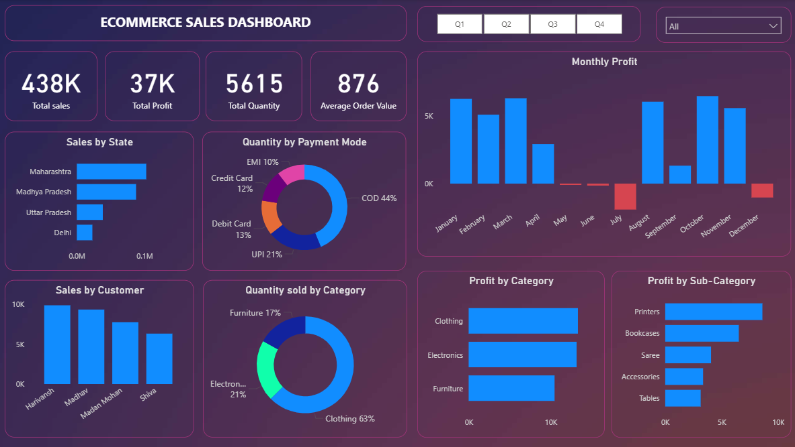

# E-Commerce Sales Dashboard | Power BI

## 📊 Project Overview

This project presents an interactive E-Commerce Sales Dashboard developed using Microsoft Power BI. It provides insights into sales performance, profitability, customer sales, product categories, payment methods, and monthly profit trends.

The dashboard includes interactive filters that allow users to explore business performance by state and quarter.

## 🛠️ Tools & Technologies

- Microsoft Power BI Desktop
- Power Query
- DAX (Data Analysis Expressions)
- Data Modeling
- Data Visualization

## 📌 Key Performance Indicators (KPIs)

The dashboard highlights four key business metrics:

| KPI | Value |
|---|---:|
| Total Sales | 438K |
| Total Profit | 37K |
| Total Quantity | 5,615 |
| Average Order Value | 876 |

*Values are rounded as displayed in the dashboard.*

## 📈 Dashboard Visualizations

The dashboard contains seven visualizations:

1. **Monthly Profit:** Analyzes monthly profit trends and identifies periods of positive and negative profitability.
2. **Sales by State:** Compares sales performance across different states.
3. **Sales by Customer:** Highlights customers based on their sales contribution.
4. **Quantity by Payment Mode:** Shows the distribution of quantities across different payment methods.
5. **Quantity Sold by Category:** Compares the quantity sold across product categories.
6. **Profit by Category:** Analyzes profit contribution from each product category.
7. **Profit by Sub-Category:** Examines profitability across individual product sub-categories.

## 🎛️ Interactive Features

The dashboard includes two interactive slicers:

- **State Slicer:** Filters dashboard data by state.
- **Quarter Slicer:** Allows users to explore performance across different quarters.

## 🔍 Key Business Insights

- Total sales are approximately 438K, with total profit of approximately 37K.
- Clothing contributes the largest share of quantity sold, accounting for approximately 63%.
- Printers are the highest-profit sub-category, generating 8,606 in profit.
- Furnishings recorded a loss of 806.
- Monthly profit was negative in May, June, July, and December.
- Comparing quantity sold and profit by category provides a better understanding of sales volume and profitability.

## 🧹 Data Preparation & Modeling

The project involved:

- Checking data types and data quality.
- Reviewing missing values, errors, and duplicate records.
- Establishing relationships between the Orders and Details tables.
- Creating a dedicated Date Table.
- Extracting year, quarter, month, and day information.
- Sorting month names chronologically using month numbers.
- Creating calculated measures using DAX.

## 🧮 DAX Measures

Some of the key DAX measures used in the project include:

**Total Sales**
```DAX
Total Sales = SUM(Details[Amount])
```

**Total Profit**
```DAX
Total Profit = SUM(Details[Profit])
```

**Total Quantity**
```DAX
Total Quantity = SUM(Details[Quantity])
```

**Unique Orders**
```DAX
Unique Orders = DISTINCTCOUNT(Details[Order ID])
```

**Average Order Value**
```DAX
Average Order Value =
DIVIDE(
    [Total Sales],
    DISTINCTCOUNT(Details[Order ID]),
    0
)
```

## 🎯 Skills Demonstrated

- Data Cleaning and Preparation
- Data Modeling
- DAX Calculations
- KPI Development
- Interactive Dashboard Design
- Data Visualization
- Business Intelligence
- Business Analysis

## 📷 Dashboard Preview



## 📁 Project Files

- `README.md` — Project documentation
- `ecommerce-sales-dashboard.png` — Dashboard screenshot
- `.pbix` — Interactive Power BI report

## 👩‍💻 Author

**Hafiza Amber Ijaz**
